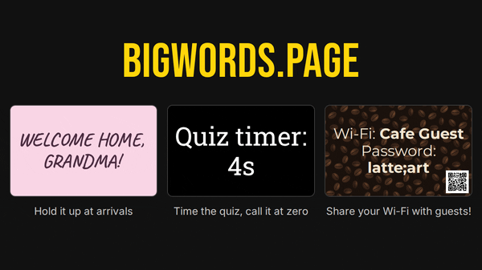

# 大字屏 (BIGWORDS)

[English](README.md) | **简体中文**

任何屏幕都能变成大字牌。在编辑器里写一句话，它会自动撑满整块屏幕，能放多大就多大。整块牌子都活在 URL 里——没有后端、没有账号、服务器上不存任何东西。在线实例：<https://bigwords.cn>，那里还提供内嵌离线版网页的 Android 应用。

<picture>
  <source media="(prefers-reduced-motion: reduce)" srcset="docs/media/demo-poster.png">
  
</picture>

## 使用

- **落地页** `/`：站点门面——它是什么、能做什么，还有一个可以上手玩的演示，「去全屏播放」按钮直接打开真正的播放页。
- **编辑器** `/app`：选效果、写内容、挑两个颜色，播放。最近用过的文字和颜色留在这台浏览器里。**控制其他屏幕**把同一块牌子交给遥控流程。
- **播放页** `/#…`：展示本身，全屏、无任何控件。分享、收藏、投在屏幕上打开的就是这个链接。（fragment 的存在也是编辑器住在 `/app` 的原因：`/` 上任何 hash 都是播放页。）
- **文档** `/docs`：参考手册，由 [`docs/REFERENCE.md`](docs/REFERENCE.md) 构建。所有 URL 参数都有记载，生成链接很容易。

特性：

- 文字自动适配任意屏幕尺寸和方向
- 一小套 Markdown 语法：加粗、斜体、标题、换行
- 多页幻灯片，用 `||` 分隔
- 倒计时：到某个时间点（`until`），或一段时长（`timer`）
- 动画、内置开源字体、按屏幕比例取景
- 二维码在浏览器里直接绘制：链接、Wi-Fi、打电话、发短信、邮件、位置
- 图片，以及播放页打开期间保持屏幕常亮

展示内容存在 URL fragment（`#` 之后）里，浏览器永远不会把它发给服务器。

## 自托管

构建产物就是一个静态文件目录，任何静态主机都行，只要 `/` 返回 `index.html`、`/app` 返回 `app.html`、`/docs` 返回 `docs.html`、其余路径以 404 状态返回 `404.html`。便携版构建（`npm run build:site`，即仓库根的 `网站/` 目录）则直接打开展示编辑器，Android 应用内嵌的就是它。如果你的主机下发 Content-Security-Policy，照抄 [`Caddyfile`](Caddyfile) 里的 `script-src`：`index.html` 有一段内联脚本，靠 hash 放行。官方支持的运行方式是 Docker 镜像。

### Docker

镜像基于官方 `caddy` 镜像，从 `/usr/share/caddy` 提供站点文件，Caddyfile 监听 `:80`、设置安全响应头、未知路径返回 `404.html`。

```sh
git clone https://github.com/mdview2026/bigwords.git
cd bigwords
docker compose up -d --build
```

`compose.yaml` 不对外发布端口（80 端口写了但被注释掉）。把服务挂到你反向代理的网络里，让代理处理 TLS，并由代理下发 `Strict-Transport-Security`。

镜像保留 Caddy 官方默认行为（包括以 root 运行），和其他 `caddy` 容器一致。站点是纯静态、不含任何秘密，但如果你想进一步收紧容器，下面的 compose 配置可用：

```yaml
services:
  bigwords:
    read_only: true
    tmpfs:
      - /data
      - /config
    cap_drop: [ALL]
    cap_add: [NET_BIND_SERVICE] # 监听 :80 需要
    security_opt: [no-new-privileges:true]
    mem_limit: 128m
    cpus: 0.5
```

想同时以非 root 用户运行的话，把 Caddyfile 改成监听 1024 以上端口（比如 `:8080`），加上 `user: "1000:1000"`，并让代理和 Dockerfile 的 `HEALTHCHECK` 指向新端口。

### 构建设置

全部可选。给 `npm run build` 设环境变量，或在 `compose.yaml`（`build.args`）/`docker build --build-arg` 里设构建参数。

| 设置 | 作用 |
|---|---|
| `SITE_URL` | 你的公开源，如 `https://signs.example.com`。补上 canonical URL、Open Graph/Twitter 卡片、首页 JSON-LD 和 `sitemap.xml`，这些都需要绝对地址。不设则全部省略。 |
| `NOINDEX` | 设为 `1` 则每个页面加 `noindex`，`robots.txt` 全站禁抓，并去掉 sitemap。用于预发布副本和私有实例。 |
| `OPERATOR_DOCS` | 追加到 `/docs` 末尾的 Markdown 文件路径，写给你的实例的说明，比如谁在运营、如何举报滥用。相对仓库根。 |
| `VITE_MQTT_URL` | 遥控功能连接的 MQTT-over-WebSocket 端点（`wss://…`），构建时写进产物。默认用公开实例的 broker；自建 broker 时设置它（见[遥控功能](#遥控功能)）。 |

### 遥控功能

遥控功能——一台手机通过 MQTT 驱动其他屏幕——需要一个 broker。开箱即用的构建指向公开实例的 broker，其凭证不在本仓库里。要在自己的实例上使用遥控：

1. 跑一个带 WebSocket 监听的 MQTT broker，并为站点建一个用户，比如 [Mosquitto](https://mosquitto.org/) 配置 `listener 1883`、`protocol websockets` 和 `password_file`。
2. 把 [`src/remote/local_settings.example.ts`](src/remote/local_settings.example.ts) 复制为 `src/remote/local_settings.ts`，填入该用户名和密码。
3. 构建时设 `VITE_MQTT_URL=wss://your-broker.example.com/mqtt`（Docker 镜像的同名构建参数也可）。

播放端会把 broker 地址放进二维码，所以控制端和屏幕跟随的是配对时的 broker，而不是构建里的那个。

## 开发

需要 Node 22.12+。CI 和 Docker 构建用的是 [`.node-version`](.node-version) 里的 LTS 版本，目前是 24。

```sh
npm install
npm run dev        # 开发服务器
npm test           # 单元测试（Vitest）
npm run typecheck
npm run build      # 静态产物输出到 dist/
npm run preview    # 在 :4173 提供 dist/
npm run smoke      # 对 preview 服务器跑浏览器冒烟测试（Playwright）
npm run clipcheck  # 检查文字墨迹不会被文本区边缘裁切
```

GitHub Actions（[`.github/workflows/ci.yml`](.github/workflows/ci.yml)）在每次推送到 `main` 和每个 PR 上跑单元测试、构建和冒烟测试。clipcheck 也会跑，但结果不影响构建成败。

遥控功能连接的 MQTT broker 的凭证不在仓库里。把 [`src/remote/local_settings.example.ts`](src/remote/local_settings.example.ts) 复制为 `src/remote/local_settings.ts` 并填入用户名、密码后再构建。CI 用占位文件构建。

社交分享卡 `public/og.png` 和 `public/apple-touch-icon.png` 由 `npm run og` 用真实播放页渲染并提交（需先跑 `npm run preview`）。改了字体或 favicon 之后重跑一次。

项目结构：

| 路径 | 用途 |
|---|---|
| `src/state/` | fragment 解析/序列化、参数校验与默认值 |
| `src/render/text.ts` | 内容管线：转义 → 分页 → Markdown → `{countdown}` |
| `src/render/display.ts` | 播放页、编辑器预览、首页共用的渲染器 |
| `src/editor/` | 编辑器界面 |
| `docs/REFERENCE.md` | 文档源文件，构建期渲染进 `/docs` |
| `public/fonts/` | 内置字体及其许可证（`npm run fonts` 重新生成） |

## 许可证

[MIT](LICENSE)。本项目是 SpeakingOfBrad 的 [BIGWORDS.PAGE](https://github.com/SpeakingOfBrad/BIGWORDS.PAGE)（同为 MIT）的二次开发。内置字体与库保留各自许可证，见 [THIRD_PARTY_NOTICES.md](THIRD_PARTY_NOTICES.md)。
